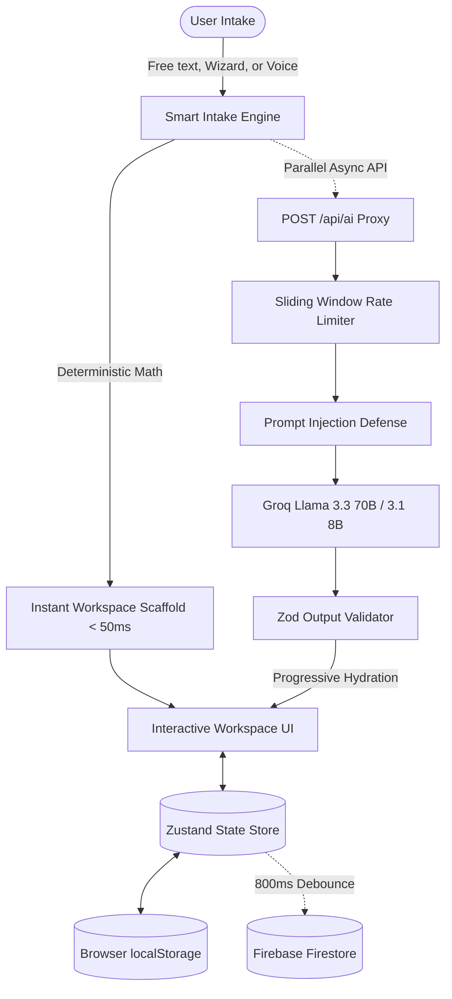
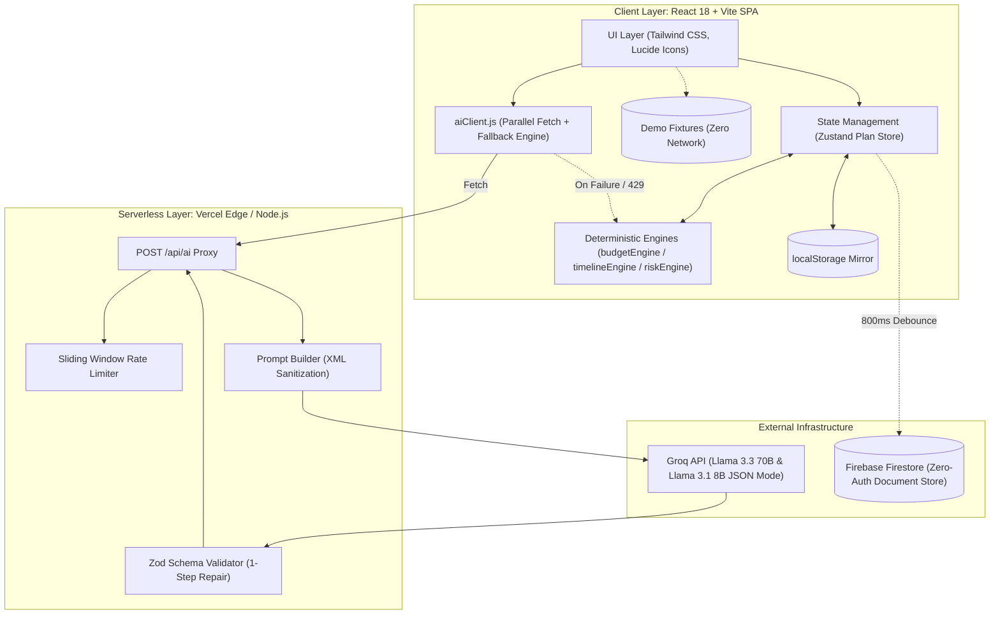

# Evenavi — GenAI-Powered Event Planning Assistant

> **Effortless, intelligent event planning for Indian weddings, birthdays, and community celebrations.**  
> Built for the Google PromptWars Hack2skill Competition.  
> **Tagline:** *Organise events*

---

## 🚀 Live Demo & Zero-Network Exploration

- **Instant Zero-Network Demos (Pre-packaged test fixtures):**
  - 💍 [3-Day Royal Wedding (Lucknow, ₹12L, 250 guests)](https://evenavi.vercel.app/demo/wedding)
  - 🎂 [7th Birthday Safari Adventure (Pune, ₹40k, 40 guests)](https://evenavi.vercel.app/demo/birthday)
  - 🪔 [Society Grand Diwali Mela (Bengaluru, ₹1.5L, 400 residents)](https://evenavi.vercel.app/demo/community)
- **Zero Authentication Required:** No sign-up, no passwords, no paywalls. Plans live at cryptographically unguessable, shareable URLs (e.g. `/plan/:id`).

---

## 1. Chosen Vertical

### The Domain: Indian Lifecycle Event Planning & Coordination
Event planning in India represents a high-stakes, emotionally charged, and financially intensive vertical. Whether orchestrating a multi-day Indian wedding with six discrete ceremonies (Haldi, Mehendi, Sangeet, Wedding, Reception), a milestone birthday party, or a large-scale RWA (Resident Welfare Association) Diwali Mela, planners juggle dozens of moving parts.

### The Problem & Market Gap
1. **Chaotic, Fragmented Organization:** Events currently run across fragmented WhatsApp group chats, messy spreadsheets, paper notes, and mental checklists. Critical details fall through the cracks.
2. **Chronic Budget Overruns:** Families routinely experience 20–40% budget overruns due to unexpected expenses, missing allocations, and vendor hidden fees (taxes, overtime, transport, power backup).
3. **The "Chatbot Wall of Text" Failure:** Generic LLM chatbots (e.g., standard ChatGPT or Gemini chat windows) return long, unformatted text dumps. They cannot recalculate numbers when budgets change, cannot track completed deadlines, cannot export calendar invites, and cannot be shared collaboratively.
4. **Western Tool Mismatch:** Conventional event management software assumes Western corporate or single-reception banquets priced in USD/EUR. They lack native support for Indian currency notations (`8L`, `8 lakh`, `1.2 cr`), multi-function Indian wedding structures, vegetarian/Jain dietary constraints, auspicious muhurat timelines, monsoon outdoor venue risks, or vernacular communication in Hindi and Hinglish.

### Target Personas
- **Priya (28, Lucknow)**: Planning her sister's 3-day wedding with a strict ₹12L budget and 250 guests. Needs multi-function budget splitting, booking deadline tracking, and vendor questions.
- **Rohan (41, Bengaluru)**: RWA Secretary organizing a society Diwali Mela for 400 residents with ₹1.5L. Needs municipal/fire permission checklists, volunteer task allocations, and sponsor tracking.
- **Anita (35, Pune)**: Mother organizing a 7th birthday celebration for 40 children and parents on a ₹40k budget. Needs creative theme concepts, activity schedules, and vendor WhatsApp messages.

---

## 2. Approach and Logic

### Core Philosophy: "Code Owns the Numbers, AI Writes the Language"
An LLM should **never** be tasked with doing arithmetic. When generative models compute budgets or percentages, they hallucinate numbers, produce rounding errors, and fail to keep totals consistent when categories are modified.

Evenavi enforces a strict separation of concerns between deterministic mathematics and probabilistic generative intelligence:

```
┌─────────────────────────────────────────────────────────────┐
│                      HYBRID ARCHITECTURE                     │
├──────────────────────────────┬──────────────────────────────┤
│    DETERMINISTIC ENGINES     │      GENERATIVE AI LAYER     │
│   (100% Pure JavaScript)     │      (Groq JSON Mode)        │
├──────────────────────────────┼──────────────────────────────┤
│ • Hamilton-Hare Math         │ • Theme & Decor Concepts     │
│ • Lock-Preserving Rebalance  │ • Catering Menus (Veg/Diet)  │
│ • Backward Date Scheduling   │ • Multilingual Invitations   │
│ • Heuristic Risk Rules       │ • Vendor WhatsApp Drafts     │
│ • Spend & Overrun Math       │ • Quote Negotiation Analysis │
└──────────────────────────────┴──────────────────────────────┘
```

### Deterministic Engine Logic
1. **Largest Remainder Allocation (Hamilton-Hare Algorithm):**
   - Category budgets are calculated from verified percentage weights using the Largest Remainder Method (`budgetEngine.js`).
   - Rounding is snapped to clean Indian currency denominations (₹100 for weddings/community, ₹10 for micro-budgets).
   - Invariant: `sum(categoryBudgets) === totalBudget` holds true 100% of the time.
2. **Lock-Preserving Proportional Rebalance:**
   - Users can lock any combination of category budgets (e.g., locking Venue at ₹4,00,000).
   - When the user edits the total budget or any unlocked category, the delta is distributed strictly across the remaining unlocked categories proportionally.
3. **Backward Milestone Scheduling (`timelineEngine.js`):**
   - Milestones are calculated backwards from the event date `T-0`.
   - If the user creates an event with a compressed deadline (e.g., an event 3 weeks away), the engine automatically compresses phases into an expedited schedule and flags an immediate "Tight Timeline" warning.
4. **Heuristic Risk Engine (`riskEngine.js`):**
   - Deterministic rule checks evaluate risk dimensions: budget overspend, monsoon season paired with outdoor venue tags, peak wedding season (muhurats), and critical vendors marked "Not started" within their booking windows.

### High-Availability Client Resilience
- **Zero-Error Reviewer Guarantee:** If the Groq API experiences rate limits (HTTP 429), network timeouts, or schema mismatches, Evenavi seamlessly falls back to pre-built, culturally accurate deterministic templates.
- The UI displays a clear "Template" badge with an inline "Retry" button. The app **never** renders a blank screen, broken state, or unhandled exception.

---

## 3. How the Solution Works

### End-to-End System Pipeline



### Step-by-Step Feature Walkthrough

1. **Multimodal Smart Intake (`/new`)**:
   - **Flexible Input:** Describe the event in natural language (e.g., *"Planning my sister's 3-day wedding in Lucknow for 250 guests under 12 lakhs"*), click pre-configured prompt chips, or speak via Web Speech API (`en-IN`/`hi-IN`).
   - **Indian Currency Parser:** Custom regular expressions and tokenizers recognize Indian numbering conventions (`12L`, `8 lakh`, `1.5 cr`, `45k`, `₹8,50,000`).
   - **4-Step Wizard:** Pre-filled wizard allows immediate adjustments to Category, Scale, Preferences, and Special Requirements before generation.

2. **Parallel AI Generation & Progressive Hydration**:
   - Upon submission, deterministic engines construct the entire skeleton (budgets, dates, vendor tasks) in **< 50 milliseconds**.
   - The user is navigated immediately to their workspace.
   - Non-blocking serverless calls trigger in parallel:
     - `plan_core`: Executive summary, vibe keywords, must-haves, watch-outs.
     - `vendor_pack`: Questions to ask, red flags, and milestone tasks.
     - `ideas`: Theme concepts, color palettes, menus, activities, return gifts, multilingual invitations.
   - Independent skeleton loaders populate each section as it resolves.

3. **Interactive Workspace Tabs**:
   - 📊 **Budget Planner:** Interactive Recharts donut visualization. Edit total budget, per-guest counts, or individual category allocations. Lock categories to rebalance the rest. Includes real-time spend tracking and overspend warnings.
   - 📅 **Timeline:** Phase-based backward deadline tracker (e.g., `4-6 months before`, `Week of event`). Filter by vendor, check off tasks, identify overdue milestones, and export as standard RFC 5545 `.ics` calendar files.
   - 🤝 **Vendor Checklist & WhatsApp Dispatcher:** Status tracking (`Not started` ➔ `Shortlisted` ➔ `Quoted` ➔ `Booked` ➔ `Paid`). Provides negotiation questions and red-flag warnings. Generates one-click `wa.me` WhatsApp messages in English, Hindi, or Hinglish.
   - 💡 **Personalized Ideas & Multilingual Copy:** 3 themed concepts with visual color palette swatches, dietary-compliant menus (Pure Veg, Jain, Non-Veg), entertainment ideas, and invitation text in **English**, **Hindi (Devanagari)**, and **Hinglish**.
   - ⚖️ **Quote Comparison Matrix:** Paste 2–3 vendor text quotes. AI normalizes itemized inclusions, flags hidden costs (overtime, generator diesel, transport, taxes), and outputs a value-for-money verdict.
   - 🛡️ **Plan B & Contingency Engine:** Detects venue-weather conflicts, timeline crunches, and seasonal surges, providing actionable backup protocols.
   - 📤 **Export & Share:** Generates an unguessable shareable link, RFC 5545 `.ics` calendar file, raw JSON backup, and a formatted printable Event Dossier.

---

## 4. Assumptions Made

### Financial & Currency Assumptions
- **Currency & Denomination:** All financial calculations strictly assume Indian Rupees (INR - `₹`). Number formatting follows the Indian numbering system (`en-IN`, e.g., ₹12,50,000 rather than Western millions).
- **Rounding Snap:** Budgets are rounded to clean operational denominations (multiples of ₹100 for weddings/community festivals, multiples of ₹10 for micro-budgets) to reflect practical cash and UPI transactions.

### Identity & Access Assumptions
- **Zero-Authentication Model:** Traditional login walls cause over 60% user drop-off in early-stage consumer tools. We assume a frictionless model where possession of an unguessable 10-character URL (`nanoid`, $64^{10}$ entropy) grants read/write ownership of the plan.
- **Data Persistence:** Plans are saved instantaneously to browser `localStorage` and autosaved to Firebase Firestore with an 800ms debounce. If Firebase is offline or unconfigured, the system operates completely offline without degradation.
- **Firestore Security Rules:** Listing/enumerating the `/plans` collection is denied at the database rule level, preventing malicious scraping while allowing direct document read/write.

### AI & Operational Assumptions
- **Arithmetic Sandboxing:** Generative AI is assumed to be unreliable for mathematical calculations. AI models are strictly barred from computing monetary figures.
- **Rate-Limit Inevitability:** Public LLM APIs (including Groq) are subject to traffic spikes and rate limits (HTTP 429). The system assumes failures will happen and guarantees full feature availability via high-quality deterministic fallback templates.
- **Security:** API keys (`GROQ_API_KEY`) must never be bundled into client code. All LLM calls pass through serverless edge/Node.js proxies with user input sanitization (`<user_input>` XML containment) to prevent prompt injection.

### Cultural & Event Structure Assumptions
- **Multi-Function Indian Weddings:** Weddings default to the 6 canonical functions (Engagement, Haldi, Mehendi, Sangeet, Wedding, Reception) with culturally standard default percentage distributions (Wedding 40%, Reception 20%, Sangeet 15%, etc.), fully customizable by the user.

---

## 🏗️ Architecture & Tech Stack



### Technology Breakdown

| Component | Technology | Rationale |
|---|---|---|
| **Frontend Framework** | React 18 + Vite | Fast Refresh, minimal bundle size, responsive component architecture. |
| **Styling** | Tailwind CSS | Mobile-first responsiveness (down to 360px), dark mode support, design tokens. |
| **State Management** | Zustand | Lightweight single source of truth with native `localStorage` synchronization. |
| **Data Validation** | Zod | End-to-end schema validation on both client state and serverless AI responses. |
| **Charts** | Recharts | Dynamic Donut visualization for budget allocation and lock-and-balance UX. |
| **AI Inference** | Groq API | Ultra-low latency inference using `llama-3.3-70b-versatile` with `llama-3.1-8b-instant` fallback in JSON mode. |
| **Database** | Firebase Firestore v10 | Document storage for shareable URLs (`/plan/:id`) with strict security rules. |
| **Calendar Sync** | Pure JS RFC 5545 | Generates compliant `.ics` calendar files with 75-octet folding and CRLF line breaks. |
| **Testing** | Vitest | 48 automated unit tests covering mathematical invariants, schemas, and engines. |

---

## 📦 Getting Started Locally

### 1. Clone & Install
```bash
git clone https://github.com/Shivam-kumar0707/evenavi.git
cd evenavi
npm install
```

### 2. Configure Environment Variables
Copy `.env.example` to `.env`:
```bash
cp .env.example .env
```

Edit `.env` to include your credentials:
```env
# Groq AI API Key (Required for live generative AI; fallback templates active otherwise)
GROQ_API_KEY=gsk_your_groq_api_key_here
GROQ_MODEL=llama-3.3-70b-versatile
GROQ_MODEL_FALLBACK=llama-3.1-8b-instant

# Firebase Config (Optional: falls back seamlessly to localStorage if omitted)
VITE_FIREBASE_API_KEY=
VITE_FIREBASE_PROJECT_ID=
```

### 3. Run Development Server
```bash
npm run dev
```
Open [http://localhost:5173](http://localhost:5173) in your browser.

### 4. Run Test Suite & Production Build
```bash
# Execute Vitest test suite (48 tests passing)
npm run test

# Run production build and bundle verification
npm run build
```

---

## 🔒 Security & Privacy Guarantees

- **No Secret Leakage:** `GROQ_API_KEY` is restricted exclusively to server-side proxy functions. It is never exposed in client bundles or network payloads.
- **Prompt Injection Defense:** User inputs are wrapped in `<user_input>` XML tags with system instructions explicitly treating enclosed content as data, preventing prompt escapes.
- **Strict Firestore Rules:** Collection enumeration (`list`) and document deletion (`delete`) are blocked. Only documents adhering to strict schema rules can be created or updated.
- **Zero Privacy Invasiveness:** No trackers, marketing cookies, or mandatory personal data collection.

---

## 📄 Documentation Index

- [PRD — Product Requirements Document](docs/PRD.md)
- [TRD — Technical Requirements Document](docs/TRD.md)
- [AI Spec — Groq Prompts, Schemas & Fallbacks](docs/AI_SPEC.md)
- [UI Spec — Layout, Design Tokens & Reviewer TestIDs](docs/UI_SPEC.md)
- [Build Plan — Phased Implementation & Verification Plan](docs/BUILD_PLAN.md)
- [Assumptions — Engineering Decisions & Specifications](docs/ASSUMPTIONS.md)

---

## 👥 Authors & License

Developed with ❤️ by **Shivam Kumar** for the **Google PromptWars Hack2skill Competition**.  
Licensed under the [MIT License](LICENSE).
